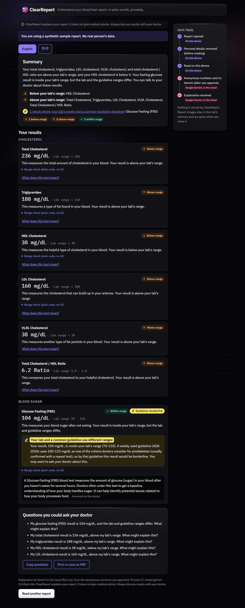
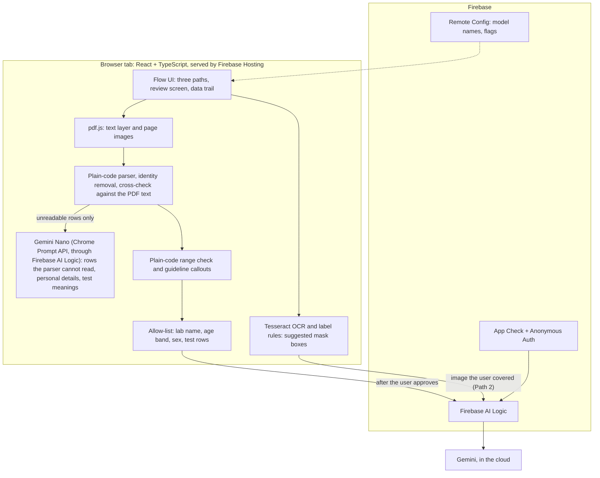

# ClearReport

**Demo video:** [Watch it on YouTube (2:53)](https://youtu.be/9BSmEUX1kyw) · **Judging?** Start with the one-page [guide for judges](docs/JUDGES.md).

**Your blood test report, explained in plain English or Hindi, with your personal details kept on your device.**

Live demo: https://clearreport-717f3.web.app (the app is at [/app](https://clearreport-717f3.web.app/app); "Try a sample report" opens it with a synthetic report loaded).



## The problem

People worry about sharing medical data with AI and upload it anyway: in KFF's February 2026 survey, 77% of US adults were concerned about the privacy of medical information given to AI tools, and 41% of those who used AI for health information had uploaded results like test reports ([KFF](https://www.kff.org/public-opinion/kff-tracking-poll-on-health-information-and-trust-use-of-ai-for-health-information-and-advice/)). And the range printed on a report is not a fixed truth: a 2026 preprint across 33,244 Indian diagnostic centres found significant variation in reference ranges ([medRxiv](https://www.medrxiv.org/content/10.64898/2026.06.01.26354654v1)), so "inside the lab's range" and "fine by a published guideline" can disagree.

## What ClearReport does

1. **Keeps your identity on your device.** Personal details are removed on the device before anything is read in the cloud, or you cover them yourself. The cloud only sees an anonymous summary that you approve.
2. **Checks the lab's range against named guidelines.** Plain code (no AI) compares each result with the lab's printed range and with a named, dated guideline (ADA 2026, NCEP ATP III, WHO 2024), and says so when they disagree.

## How it works

You pick one of three paths, and a data trail beside every step shows what happens on the device and what goes to the cloud.

- **Path 1, Private:** a lab PDF is read entirely on the device (a plain-code parser, with on-device Gemini Nano for layouts it does not know). Only anonymous numbers go to the cloud, after you approve them.
- **Path 2, Mask it yourself:** for a photo or scan. On-device OCR suggests boxes over your name, ID and phone; you check them, and only the covered image is sent, after you see it.
- **Path 3, Full report:** sends everything after explicit consent. Paused while the project is on Gemini's free tier.

Every value is cross-checked against the PDF's own text ("Verified against your PDF" or "Please check this value"). The range check, guideline callouts and findings summary are plain code, so they are the same whatever the model writes.

## System design

ClearReport is a static web app. There is no server of our own and no database: everything about a report happens in the browser tab, and the only things that leave it go to Gemini through Firebase AI Logic, after the user approves them.



| Part | Where | Role |
| --- | --- | --- |
| Reading and parsing | the browser | pdf.js, the plain-code parser, OCR and the on-device model turn a report into rows; personal details are dropped here |
| Trust and checks | the browser | each value is verified against the PDF text; range checks and guideline wording are plain code |
| Privacy boundary | the browser | only the allow-listed anonymous summary, or an image the user covered and approved, is sent |
| Explanation | Gemini in the cloud | writes the plain-language explanation and the Hindi version from the approved numbers |
| Platform | Firebase | Hosting, App Check, Anonymous Auth, Remote Config and AI Logic |

## How we use Firebase AI Logic

Every AI call in the app, with its inference mode:

| Mode | What it does | What data it sees | Code |
| --- | --- | --- | --- |
| `ONLY_ON_DEVICE` | Path 1: reads result rows the plain-code parser could not read, with their neighbouring lines | Blocks of lines from the PDF text around those rows, with identity lines already dropped | [src/extract.ts:243](src/extract.ts#L243) |
| `ONLY_ON_DEVICE` | Path 2, optional "Look for more personal details": finds names, IDs and phone numbers in the OCR text so they can be boxed | The page's OCR text, which never leaves the device | [src/extract.ts:207](src/extract.ts#L207) |
| `ONLY_ON_DEVICE` | Evaluation only (dev spike page): reads a report image on the device | Synthetic test images | [src/extract.ts:73](src/extract.ts#L73) |
| `ONLY_IN_CLOUD` | Paths 2 and 3: reads the results from the image | Path 2: the image the user covered and approved. Path 3: the full image, with consent | [src/extract.ts:80](src/extract.ts#L80) |
| `ONLY_IN_CLOUD` | Writes the explanation, and the Hindi translation when the user taps Hindi | The approved payload: lab name, age band, sex, test names, values, units, printed ranges and flags, plus the plain-code range-check results | [src/explain.ts:55](src/explain.ts#L55) |
| `PREFER_ON_DEVICE` | "What does this test mean?" | The test's name only, never a value | [src/explain.ts:179](src/explain.ts#L179) |

Path 1 never falls back to the cloud: if the device cannot run the model, the app says so and offers the other paths. When the cloud model is busy, calls retry with backoff and then try a fallback model once; a free-tier daily limit stops the call at once and shows the plain range-check summary.

**Design principle:** plain code where rules are reliable, on-device AI where data is private, cloud AI where data is anonymous or you chose to send it.

Also: **App Check** (reCAPTCHA Enterprise) so only the ClearReport web app can call Gemini, **Anonymous Authentication** (no account or email), **Remote Config** (cloud model, fallback model, prompt version, and switches for Hindi and Path 3, with in-code defaults), and **Hosting**.

## Results

- **Synthetic reports:** the cloud read 100% of values, units, ranges and flags on all 6 clean images and both phone photos.
- **Dr Lal PathLabs public sample PDFs:** Path 1 reads them on the device with the plain-code parser, 32 of 32 and 54 of 54 rows, with no on-device model call.
- **Unfamiliar layouts:** on a layout the parser has never seen, Gemini Nano on the device returned all 10 results right in one call, and every row verifies against the PDF text.
- **No wrong value is marked as verified:** `npm test` shifts and swaps values and checks that none verifies. `npm run privacy-proof` intercepts every Gemini request and checks that no name, ID or phone leaves the device.

## Limitations

- The guideline thresholds have not been reviewed by a doctor, and cover 7 tests; every other test uses the lab's printed range only.
- Path 1 needs desktop Chrome with its built-in AI and a PDF with a text layer; photos and scans go through Path 2.
- Accuracy was measured on 2 real sample reports from one lab chain and on synthetic reports. Adult ranges only.

## Try it

Open https://clearreport-717f3.web.app and click "Try a sample report" (a fictional patient). More synthetic reports are in [test-data/reports](test-data/reports): `demo-unfamiliar.pdf` (a layout the parser does not know), `r6-photo.jpg` (a phone photo) and `r2.png`.

**To use Path 1 (on-device AI)** you need desktop Chrome 139 or newer with 16 GB of RAM or a graphics card with more than 4 GB of memory. Set `chrome://flags/#prompt-api-for-gemini-nano` and `chrome://flags/#optimization-guide-on-device-model` to Enabled, restart Chrome, and check `chrome://on-device-internals` for the model status.

## Run locally

Needs Node.js, a Firebase project on the Blaze plan with **AI Logic** (Gemini Developer API), **Anonymous** sign-in and **App Check** (reCAPTCHA Enterprise) set up, and desktop Chrome for Path 1.

```bash
cp .env.example .env   # fill in the web app config, the reCAPTCHA site key and a debug token
npm install
npm run dev            # http://localhost:5173
npm test               # parser, privacy, range checks, wording, trust badges
npm run build          # type check, build, and fail if dev-only secrets reached dist/
```

## Built during the submission period

All of it, from scratch, starting 21 November 2026: the three paths, the on-device PDF reader and parser, the masking tool, identity removal, the PDF cross-check, the guideline range check, the explanation screen with Hindi, the data trail, and the test and evaluation harness.

## License

[Apache-2.0](LICENSE)
