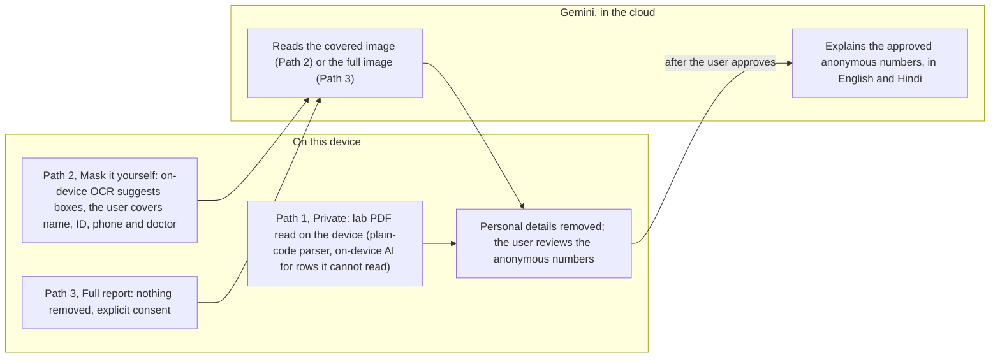

# ClearReport

**Demo video:** [Watch it on YouTube (2:53)](https://youtu.be/9BSmEUX1kyw) · **Judging?** Start with the one-page [guide for judges](docs/JUDGES.md).

**Your blood test report, explained in plain English or Hindi, with your personal details kept on your device.**

Live demo: https://clearreport-717f3.web.app (the app is at [/app](https://clearreport-717f3.web.app/app); "Try a sample report" opens it with a synthetic report loaded).


## The problem

- **People worry about sharing medical data with AI, and upload it anyway.** In KFF's February 2026 survey of US adults, 77% were concerned about the privacy of medical information given to AI tools, and 41% of those who used AI for health information had uploaded personal medical information such as test results ([KFF](https://www.kff.org/public-opinion/kff-tracking-poll-on-health-information-and-trust-use-of-ai-for-health-information-and-advice/)).
- **The printed range is not a fixed truth.** Most Indian laboratories take reference values from kit inserts or Western literature ([C-RIDL, Clin Chem Lab Med 2018](https://doi.org/10.1515/cclm-2018-0152)), and a 2026 preprint across 33,244 Indian diagnostic centres found significant variation in reference ranges ([medRxiv](https://www.medrxiv.org/content/10.64898/2026.06.01.26354654v1)). So "inside the lab's range" and "fine by a published guideline" can disagree, and nobody tells the patient.

## What ClearReport does differently

1. **Privacy by design.** Personal details are removed on the device before anything is read in the cloud, or the user covers them before sending. The cloud explanation only sees an allow-listed, anonymous summary that the user approved.
2. **The lab's range is checked against named guidelines.** Plain code (no AI) compares each result with the lab's printed range and with a named, dated guideline (ADA 2026, NCEP ATP III, WHO 2024). When they disagree, the card says so.

## How it works

The user picks one of three paths. A data trail beside every step shows what happens on the device and what goes to the cloud.



1. **Read.** Path 1 reads a lab PDF entirely on the device. Path 2 sends only an image the user has masked, after showing the exact image. Path 3 sends the full report, only after consent.
2. **Check.** Each value gets a badge ("Verified against your PDF", "Please check this value", "Read from image"); the user approves the anonymous summary.
3. **Explain.** Gemini explains the approved numbers. The range check, guideline callouts and findings summary are plain code, so they are the same whatever the model writes.

## How we use Firebase AI Logic

Every AI call in the app, with its inference mode:

| Mode | What it does | What data it sees | Code |
| --- | --- | --- | --- |
| `ONLY_ON_DEVICE` | Path 1: reads result rows the plain-code parser could not read, with their neighbouring lines (see [Accuracy and evaluation](#accuracy-and-evaluation)) | Blocks of lines from the PDF text around those rows, with identity lines already dropped | [src/extract.ts:243](src/extract.ts#L243) |
| `ONLY_ON_DEVICE` | Path 2, optional "Look for more personal details": finds names, IDs and phone numbers in the OCR text so they can be boxed | The page's OCR text, which never leaves the device | [src/extract.ts:207](src/extract.ts#L207) |
| `ONLY_ON_DEVICE` | Evaluation only (dev spike page): reads a report image on the device | Synthetic test images | [src/extract.ts:73](src/extract.ts#L73) |
| `ONLY_IN_CLOUD` | Paths 2 and 3: reads the results from the image | Path 2: the image the user covered and approved. Path 3: the full image, with consent | [src/extract.ts:80](src/extract.ts#L80) |
| `ONLY_IN_CLOUD` | Writes the explanation, and the Hindi translation when the user taps Hindi | The approved payload: lab name, age band, sex, test names, values, units, printed ranges and flags, plus the plain-code range-check results | [src/explain.ts:55](src/explain.ts#L55) |
| `PREFER_ON_DEVICE` | "What does this test mean?" | The test's name only, never a value | [src/explain.ts:179](src/explain.ts#L179) |

Path 1 never falls back to the cloud: if the device cannot run the model, the app says so and offers the other paths. When the cloud model is busy, calls retry with backoff, then try a fallback model from Remote Config once; a free-tier daily limit stops the call at once and shows the plain range-check summary ([details](docs/evaluation.md#when-the-cloud-model-is-busy-and-the-daily-limit)).

**Design principle:** plain code where rules are reliable (parsing, identity removal, range checks, guideline wording), on-device AI where data is private (reading the PDF, finding personal details), cloud AI where data is anonymous (the explanation) or the user chose to send it (a covered or consented image).

## Other Firebase products

| Product | What it does here |
| --- | --- |
| App Check (reCAPTCHA Enterprise) | Only the ClearReport web app can call Gemini through Firebase AI Logic. A debug token is used in local development only. |
| Anonymous Authentication | An anonymous Firebase user per session, with no account, email or name. |
| Remote Config | Cloud model (`cloud_model`, default `gemini-3.5-flash-lite`), fallback model, prompt version, and switches for Hindi and Path 3, with in-code defaults if it cannot be fetched. |
| Hosting | Serves the static app with `nosniff`, `no-referrer` and a Permissions-Policy that turns off camera, microphone and location. |

## Accuracy and evaluation

Numbers from `npm run eval` and `npm test`; the full tables and runs are in [docs/evaluation.md](docs/evaluation.md).

- **Synthetic reports (6 layouts):** the cloud read 100% of values, units, ranges and flags on all 6 clean images and both phone photos, with no personal field missed.
- **Dr Lal PathLabs public sample PDFs (WM14, WM15):** Path 1 reads them on the device with the plain-code parser: 32 of 32 and 54 of 54 rows, no on-device model call. Against hand-made ground truth the values score 94% and 96% (cloud runs: 97% and 78%).
- **Unfamiliar layouts:** the parser improved with general rules (not rules for the test files), and layouts it still cannot read fall back to the on-device model. On `demo-unfamiliar.pdf` (10 tests in two-column cards) the model returned every name, value and range right in one call, and every row verifies against the PDF text.
- **On-device image reading did not hold up** (91% of values but 58% of ranges on clean images; 66% and 19% on phone photos), so Path 1 reads PDF text and photos go through Path 2.
- **No wrong value is marked as verified.** Each value, unit and range is cross-checked against the PDF's own text layer on the device; `npm test` shifts every WM14 and WM15 value and swaps values between tests, and checks that none verifies. Values that do not match show as "Please check this value" and must be confirmed.

## Privacy and safety

- **Allow-listed payload.** The explanation call receives only lab name, age band, sex and the test rows ([src/privacy.ts](src/privacy.ts)); identity values found in the report are also searched for literally and removed. `npm run privacy-proof` intercepts every Gemini request and checks this.
- **Nothing is stored.** Report images stay in the tab's memory. There is no database and no storage bucket.
- **Gemini terms.** The Gemini Developer API runs on Google's free tier; only anonymous numbers or a masked image you approved are sent. Path 3 (full report, per-report consent that is never remembered) is paused while on the free tier (`path3_enabled` is false in Remote Config).
- **Build guard.** `npm run build` fails if the App Check debug token or dev-only code reaches `dist/` ([scripts/check-dist.mjs](scripts/check-dist.mjs)).
- **No medical advice.** A disclaimer sits at the top of every step, and wording rules ban diagnosis-style phrases, checked in code on every message and AI answer. A notice asks for confirmation of age 18 or over, because children's ranges differ.
- **Guidelines pending review.** The thresholds come from ADA 2026, NCEP ATP III, WHO 2024 and a Lipid Association of India note, each checked against its source text ([docs/guidelines.md](docs/guidelines.md)); a doctor has not yet reviewed them.

## Limitations

- Guideline checks cover 7 tests; every other test is compared with the lab's printed range only.
- Path 1 needs desktop Chrome with its built-in AI and a lab PDF with a text layer. Scanned PDFs and photos go through Path 2.
- Accuracy was measured on 2 real sample reports from one lab chain and on synthetic reports; other labs' layouts may differ.
- The explanation is written by a cloud model. Its wording is checked, but its descriptions of what a test measures are not reviewed by a doctor. Hindi is a translation and is not shown if it changes any number.
- Adult ranges only.

## Try it

1. Open https://clearreport-717f3.web.app and click "Try a sample report" (the synthetic `demo.pdf`, a fictional patient), or open [/app](https://clearreport-717f3.web.app/app) and add your own.
2. More synthetic reports are in [test-data/reports](test-data/reports): `r2.png` (a lab range that disagrees with a guideline), `r6-photo.jpg` (a phone photo), `demo-unfamiliar.pdf` and `p1.pdf` to `p3.pdf` (text PDFs for Path 1). Dr Lal PathLabs' public samples: [WM14.pdf](https://cdn1.lalpathlabs.com/live/reports/WM14.pdf), [WM15.pdf](https://cdn1.lalpathlabs.com/live/reports/WM15.pdf).

**To use Path 1 (on-device AI)** you need desktop Chrome 139 or newer on a laptop or desktop with 16 GB of RAM or a graphics card with more than 4 GB of memory, and free disk space for the model. Open `chrome://flags/#prompt-api-for-gemini-nano` and `chrome://flags/#optimization-guide-on-device-model`, set both to Enabled, restart Chrome, and check `chrome://on-device-internals` for the model status. See Chrome's [built-in AI documentation](https://developer.chrome.com/docs/ai/get-started).

## Run locally

Prerequisites: Node.js (developed on Node 24), a Firebase project on the Blaze plan, and desktop Chrome for Path 1.

1. In the Firebase console: add a web app, enable **AI Logic** with the Gemini Developer API, enable **Anonymous** sign-in, and set up **App Check** with a reCAPTCHA Enterprise key (same Google Cloud project, reCAPTCHA Enterprise API enabled). Add a debug token for local development.
2. `cp .env.example .env` and fill in the web app config, the reCAPTCHA site key and the debug token.
3. Optional: `npx firebase-tools deploy --only remoteconfig` to publish the Remote Config defaults.

```bash
npm install
npm run dev            # http://localhost:5173
npm test               # parser, privacy, range checks, wording, questions, trust badges
npm run build          # type check, build, and fail if dev-only secrets reached dist/
npm run privacy-proof  # intercept every Gemini request and check it (needs npm run dev)
npm run gen            # regenerate the synthetic reports and ground truth
npm run eval           # score saved extraction runs in test-data/runs, write test-data/results.md
```

`npm run eval` scores runs saved from the dev evaluation page (`http://localhost:5173/?spike`); the runs are not in the repository.

## Built during the submission period

All of it, from scratch, starting 21 November 2026: the three paths, the on-device PDF reader and parser, the masking tool, identity removal, the trust badges and PDF cross-check, the guideline range check, the explanation screen with Hindi, the data trail, the evaluation harness and synthetic reports.

## Roadmap

- A lab range registry built from non-personal data only, so differences between labs are visible.
- Move the Gemini Developer API to the paid tier before wider use, and turn Path 3 back on.
- More Indian languages, an Android app using Gemini Nano, and ABDM integration so reports can come from a health locker with consent.

## License

[Apache-2.0](LICENSE)

## Design credits

No UI library is installed. These MIT-licensed designs were used as visual references only and rebuilt in plain CSS and SVG:

No UI library is installed. These MIT-licensed designs were used as visual references only and rebuilt in plain CSS and SVG:

- Visual identity "Specimen" (our own; see [the spec](docs/superpowers/specs/2026-11-23-ui-theme-design.md)): stain violet for on this device, eosin rose for the cloud, highlighter yellow only where your lab and a guideline disagree. Every colour pair passes WCAG AA (`npx tsx scripts/contrast.ts --table`). Type is IBM Plex Sans, Plex Mono and Plex Sans Devanagari (SIL Open Font License), self-hosted with Fontsource.
- The "What leaves your device" beam: Magic UI "Animated Beam" by dillionverma, MIT, https://21st.dev/@dillionverma/components/animated-beam
- The Data trail timeline: Dice UI "Timeline", MIT, https://21st.dev/@diceui/components/timeline
- The upload drop zone: "File Upload" by Edu Calvo (educlopez) on 21st.dev, MIT (its component page now returns 404)
- The landing page hero (perspective grid and centred layout): "Hero Section Dark" by kinfe123 / FarmUI, MIT, https://21st.dev/@kinfe123/components/hero-section-dark
- The landing "How it works" bento grid (card sizes on a six-column grid, a small illustration in each card): "Marketing Feature Bento" on 21st.dev, licence not stated on the page, so only the layout idea was used and no code was copied; the illustrations show ClearReport's own steps
- The "Your report" / "Sent to explain" compare slider on the landing page: "Compare Reveal" from Motiq, MIT, https://motiq.dev/components/compare-reveal (rebuilt on a native range input, without the spring physics)
- The landing footer (diagonal light shaft and the large cropped wordmark): "Beam Wordmark Footer" by Kedhar (kedhareswer) on 21st.dev, licence not stated on the page, so only the look was used and no code was copied
